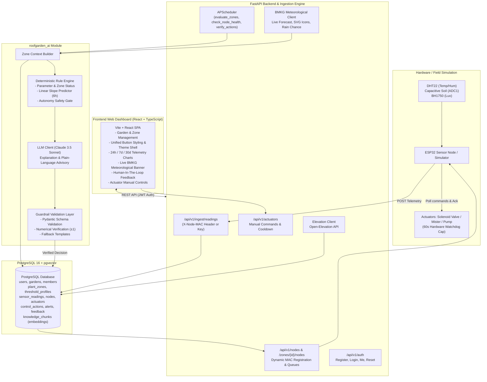

# AI Powered Roof Garden Monitoring System (MENARA)

An end-to-end, agentic IoT monitoring and automation system specifically engineered for rooftop gardens in tropical microclimates (such as Jakarta, Indonesia). **Sensor nodes** monitor soil moisture, temperature, humidity, and solar illuminance. An agentic AI pipeline periodically evaluates plant zones using real-time sensor metrics, official BMKG weather forecasts, and agronomic threshold profiles, producing human-readable explanations and issuing low-risk automated irrigation actions backed by strict deterministic guardrails.

---

## Architecture Overview



---

## Monorepo Modules

1. **`hardware`**: ESP32 DevKit firmware written in C++ (PlatformIO Arduino framework) interfacing DHT22, BH1750, capacitive soil moisture sensor (ADC1), and active-low relays with hardware safety timeouts. Includes an in-memory ring-buffer for offline resilience during WiFi/network drops.
2. **`backend`**: FastAPI application handling sensor ingestion, background task scheduling via APScheduler, BMKG live weather caching and heuristics, multi-tenant garden and member management, manual actuator dispatch with cooldowns, and RESTful APIs.
3. **`ai` (`roofgarden_ai`)**: Pure Python agentic module. Combines deterministic botanical rule engines, linear moisture depletion forecasting, and LLM plain-language reasoning guarded by strict assertion checks and deterministic safety fallbacks.
4. **`frontend`**: Responsive Single Page Application built with Vite, React, TypeScript, TanStack Query, Recharts, and Tailwind CSS. Features a unified button styling hierarchy, accessible garden and zone controls, interactive "Why?" advisory panels, and human-in-the-loop feedback.

---

## Key Features

- **Domain-Specific Hardware Abstraction**: Strict architectural separation between **Sensor Nodes** (telemetry inputs) and **Actuators** (controllable outputs like irrigation pumps, misters, and grow lights).
- **Dynamic ESP32 Sensor Node Registration**: Register sensor nodes directly to plant zones from the web app using hardware MAC addresses (`WiFi.macAddress()`), eliminating pre-shared API keys. Unregistered MAC addresses are rejected with 401 Unauthorized (auto-discovery disabled).
- **Multi-Tenant Garden Lifecycle**: Create, update, share, and delete gardens with cascading cleanups and role-based permissions (`owner` vs. `member`).
- **Live Meteorological Integration (BMKG)**: Real-time multi-day weather forecasts parsed for Indonesian sub-districts (`adm4`), featuring automated precipitation chance heuristics and official BMKG SVG weather icons.
- **Botanical Threshold Profiles**: Pre-calibrated baseline microclimate profiles for Leafy Greens, Fruiting Vegetables, Herbs, and Potted Fruit Trees (*Tabulampot*) accessible via `/api/v1/gardens/categories`.
- **Deterministic Autonomy & Safety Guardrails**: Automated irrigation triggers are restricted to low-risk crops, require rain forecast $< 50\%$, enforce daily volume limits, and are guarded against LLM hallucinations.
- **Manual Actuator Safety**: Manual triggers strictly enforced with a **60-second hardware maximum cap** and a **5-minute cooldown window** to prevent overwatering and pump burnouts.
- **Human-In-The-Loop Decision Logging**: Alerts can be confirmed or overridden with gardener reasoning, logged to the `Feedback` audit table.

---

## Quickstart

### Prerequisites
- Python 3.11+
- Node.js 18+ and npm
- Docker & Docker Compose

### 1. Environment Setup
Copy the environment template:
```bash
cp .env.example .env
```

### 2. Full Stack Quickstart (Docker Compose)
Run the entire production-grade stack (PostgreSQL + TimescaleDB, Backend API, Frontend Nginx):
```bash
docker compose up -d --build
```
Access points:
- **Frontend SPA**: `http://localhost:5173`
- **Backend API & Docs**: `http://localhost:8000/docs`
- **PostgreSQL**: `localhost:5432` (credentials from `.env`)

### 3. Local Development (Without Docker)

#### Backend Setup
```bash
cd backend
python -m venv .venv
# On Windows:
.\.venv\Scripts\activate
# On Linux/macOS:
source .venv/bin/activate

pip install -e ../ai && pip install -e .
uvicorn app.main:app --reload --port 8000
```

Seed demo data (Jakarta rooftop garden, zones, sensor nodes, actuators, and literature profiles):
```bash
python scripts/seed_demo_data.py
```

#### Frontend Setup
```bash
cd frontend
npm install
npm run dev
```
Navigate to `http://localhost:5173`.

### 4. Hardware Simulation (No Physical ESP32 Required)
Test real-time telemetry ingestion and command polling using the simulator script:
```bash
# In another terminal:
python scripts/simulate_node.py --scenario normal
# Test drying conditions:
python scripts/simulate_node.py --scenario dry
# Test heatwave conditions:
python scripts/simulate_node.py --scenario heatwave
```

### 5. Hardware Firmware Flashing
Inspect and compile the firmware with PlatformIO:
```bash
cd hardware/firmware
cp include/secrets.example.h include/secrets.h
# Edit secrets.h with WiFi and Node API keys
pio run
# To upload to a plugged-in ESP32:
pio run -t upload
```

---

## Testing & Quality Assurance

The project enforces comprehensive test coverage across backend business logic, agentic AI modules, and API contracts. For the formal ISO/IEC/IEEE 29119 compliant test strategy, quality gates, and traceability matrix, see the [Software Test Plan](file:///C:/Projects/G7_RPLProject_Menara/docs/test-plan.md).

### 1. Backend Pytest Suite (89% Coverage)
Run unit and integration tests across auth, garden lifecycles, dynamic MAC registration, actuator cooldowns, background jobs, and alert feedback:
```bash
cd backend
pytest -v --cov=app --cov-report=term-missing tests/
```
*Current test metrics: **69 passing tests**, 89% code coverage.*

### 2. AI Module Pytest Suite
Verify botanical status categorization, linear moisture slope forecasting, autonomy gating, and guardrail verification:
```bash
cd ai
pytest -v
```
*Current test metrics: **31 passing tests**, 0 failures.*

### 3. End-to-End API Test Suite
Run comprehensive live REST contract tests against the running backend (93 assertions covering all endpoints, auto-generating [`api_docs.md`](file:///C:/Projects/G7_RPLProject_Menara/api_docs.md)):
```bash
python scripts/test_endpoints.py
```
*Current test metrics: **93/93 passed (100%)**.*

### 4. Frontend Lint & Build
Verify React TypeScript typing, ESLint rules, and production bundle build:
```bash
cd frontend
npm run lint
npm run build
```

---

## Domain Guidelines & Rules

All development adheres to project invariants detailed in [`AGENTS.md`](file:///C:/Projects/G7_RPLProject_Menara/AGENTS.md):
- **Terminology**: Never use the ambiguous term "device"; use **Sensor Nodes** (inputs) and **Actuators** (outputs).
- **Button Styling**: Always utilize standardized CSS classes (`.app-btn-primary`, `.app-btn-secondary`, `.app-btn-danger`, `.app-btn-danger-solid`, `.zone-chip`) from `frontend/src/styles/app-shell.css`.
- **External Meteorological APIs**: Parse multi-day nested forecast slots from BMKG, matching UTC now, and apply rain probability heuristics when direct percentages are omitted.
