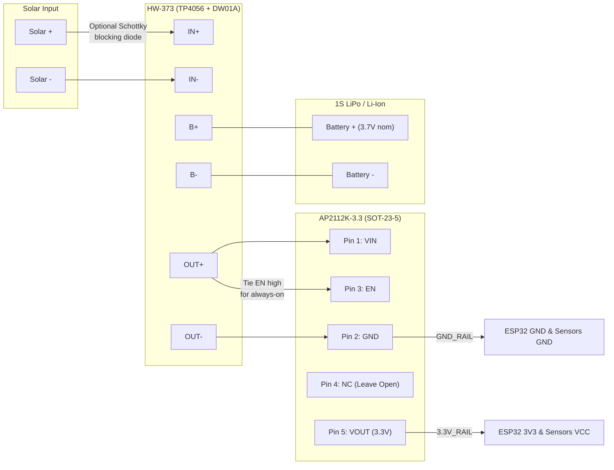

# Menara Hardware Circuit Diagram

This document describes the hardware schematic, power distribution, and GPIO pin mapping for the **MENARA RoofGarden ESP32 Sensor Node**, derived from the firmware configuration in [`hardware/firmware/include/config.h`](../hardware/firmware/include/config.h) and [`hardware/firmware/src/main.cpp`](../hardware/firmware/src/main.cpp).

---

## 1. Complete System Circuit Diagram

```mermaid
flowchart LR
    subgraph PWR["Power & Charging Stage"]
        direction TB
        SOLAR["Solar Panel<br/>(5V–6V Nominal)"]
        HW373["HW-373 Charge Controller<br/>(TP4056 + DW01A Protection)<br/>IN+ / IN- | B+ / B- | OUT+ / OUT-"]
        BATT["3.7V Li-Ion / LiPo<br/>Rechargeable Battery<br/>(1S, 3.0V–4.2V)"]
        LDO["AP2112K-3.3 LDO<br/>(SOT-23-5, 600mA)<br/>1:VIN  2:GND  3:EN  5:VOUT"]
        CIN["C_in: 1µF–10µF<br/>Ceramic Cap"]
        COUT["C_out: 1µF–10µF<br/>Ceramic Cap"]

        SOLAR -->|"V_solar (+)"| HW373
        SOLAR -->|"GND (-)"| HW373
        HW373 <-->|"B+ / B-"| BATT
        HW373 -->|"OUT+ (3.0V–4.2V)"| CIN
        HW373 -->|"OUT+ (VIN & EN)"| LDO
        CIN ---|"GND"| HW373
        LDO -->|"VOUT (Regulated 3.3V)"| COUT
        COUT ---|"GND"| LDO
    end

    subgraph MCU["Controller (esp32dev)"]
        direction TB
        ESP["ESP32 DevKit<br/>(Board: esp32dev)<br/><br/>3V3 | GND<br/>GPIO0 (BOOT / CONFIG_BUTTON_PIN)<br/>GPIO2 (STATUS_LED_PIN, optional)<br/>GPIO4 (DHT_PIN)<br/>GPIO21 (I2C_SDA_PIN)<br/>GPIO22 (I2C_SCL_PIN)<br/>GPIO26 (RELAY_PIN, Active-LOW)<br/>GPIO32 (SOIL_PIN, ADC1)"]
        BTN["Onboard BOOT Button<br/>(Active-LOW, Hold 3s on Boot<br/>for Captive Portal)"]
        BTN ---|"GPIO0 -> GND"| ESP
    end

    subgraph SENS["Sensors (3.3V Logic & Supply)"]
        direction TB
        BH1750["BH1750 (GY-302)<br/>Ambient Light Sensor<br/>I2C Addr: 0x23"]
        DHT22["DHT22 (AM2302)<br/>Temp & Humidity Sensor<br/>1-Wire Digital"]
        RPULL["4.7kΩ–10kΩ<br/>Pull-up Resistor"]
        SOIL["Capacitive Soil Moisture<br/>Sensor v1.2<br/>Analog Output (AOUT)"]

        DHT22 ---|"DATA Pull-up to 3.3V"| RPULL
    end

    subgraph ACT["Actuator"]
        direction TB
        RELAY["Sprinkler Relay Module<br/>(Active-LOW Trigger)<br/>IN | VCC | GND"]
        VALVE["Solenoid Valve / Pump<br/>& External Load Supply"]
        RELAY -->|"COM / NO Switch"| VALVE
    end

    %% Power Rails
    LDO -->|"3.3V Rail"| ESP
    LDO -->|"3.3V Rail"| BH1750
    LDO -->|"3.3V Rail"| DHT22
    RPULL -->|"3.3V Rail"| LDO
    LDO -->|"3.3V Rail"| SOIL
    HW373 -.->|"OUT+ (3.7V–4.2V) or<br/>External 5V for Coil*"| RELAY

    %% Sensor Signal Connections
    BH1750 <-->|"SDA <-> GPIO21"| ESP
    BH1750 <--|"SCL <-- GPIO22"| ESP
    DHT22 <-->|"DATA <-> GPIO4"| ESP
    SOIL -->|"AOUT --> GPIO32 (ADC)"| ESP

    %% Actuator Control
    ESP -->|"GPIO26 --> IN (Active-LOW)"| RELAY
```

> **\*Relay Power Note:** If using a **5V relay module** (as listed in [`docs/architecture.md`](./architecture.md)), its coil `VCC` requires a 5V supply (or a 3.3V-compatible relay / MOSFET driver) while `GPIO26` drives the Active-LOW `IN` pin. Do **not** draw solenoid valve or high-current relay coil power through the AP2112K-3.3 (`600mA` max, shared with ESP32 Wi-Fi TX peaks).

---

## 2. Power Stage & AP2112K-3.3 Wiring Detail



### Power Stage Design Notes
1. **Solar Panel to HW-373 (`IN+` / `IN-`):**
   - The TP4056 IC on the HW-373 is rated for **4.5V–5.5V** (absolute max ~8V, thermal dissipation climbs rapidly above 5.5V). Use a **5V–6V nominal solar panel**; if open-circuit voltage exceeds ~6V, add a 5V–5.5V buck/clamp or ensure panel load voltage stays within TP4056 limits.
   - Adding a Schottky diode in series on `Solar +` prevents reverse leakage into the solar cell at night (note its ~0.3V forward drop).
2. **Battery & Protection (`B+` / `B-` vs `OUT+` / `OUT-`):**
   - Connect the 3.7V cell directly to `B+` and `B-`.
   - Connect the downstream regulator (`AP2112K-3.3`) to `OUT+` and `OUT-` so the HW-373's DW01A protection IC guards the battery against over-discharge and short circuits.
3. **AP2112K-3.3 Regulation:**
   - Dropout voltage is typically **~250mV at 600mA**, allowing regulated **3.3V** down to ~3.55V battery voltage.
   - Bypass the ESP32 DevKit's onboard AMS1117 regulator by feeding `AP2112K-3.3 VOUT` directly into the ESP32 **`3V3`** pin (not `VIN`/`5V`).
   - Place **1µF–10µF** ceramic decoupling capacitors close to `VIN`–`GND` and `VOUT`–`GND`, plus an additional **100µF–470µF** bulk capacitor on the `3.3V` rail to absorb ESP32 Wi-Fi transmission current spikes (~300–500mA).
   - **Important:** Do not connect USB to the ESP32 DevKit simultaneously while `3V3` is externally powered by the AP2112K-3.3 unless USB 5V/3.3V back-feed is isolated.

---

## 3. Firmware Pinout & Netlist Reference

All pin assignments below are extracted directly from [`hardware/firmware/include/config.h`](../hardware/firmware/include/config.h), [`hardware/firmware/src/sensors/`](../hardware/firmware/src/sensors/), and [`hardware/firmware/src/actuators/relay.cpp`](../hardware/firmware/src/actuators/relay.cpp):

| Component | Module Pin | ESP32 Pin / Net | Firmware Macro | Configuration & Notes |
| :--- | :--- | :--- | :--- | :--- |
| **AP2112K-3.3** | `VOUT` (Pin 5) | `3V3` Rail | — | Powers ESP32 `3V3` and all 3.3V sensors |
| **AP2112K-3.3** | `GND` (Pin 2) | `GND` Rail | — | Common ground across HW-373 `OUT-`, ESP32, sensors, relay |
| **BH1750 (GY-302)** | `VCC` | `3.3V` | — | 3.3V supply |
| **BH1750 (GY-302)** | `GND` | `GND` | — | Common ground |
| **BH1750 (GY-302)** | `SDA` | `GPIO21` | `I2C_SDA_PIN` (`21`) | I2C Data (`Wire.begin(21, 22)`) |
| **BH1750 (GY-302)** | `SCL` | `GPIO22` | `I2C_SCL_PIN` (`22`) | I2C Clock |
| **BH1750 (GY-302)** | `ADDR` | `GND` (or NC) | Default `0x23` | `LightSensor` defaults to I2C address `0x23` (`ADDR` low) |
| **DHT22 (AM2302)** | `VCC` | `3.3V` | — | 3.3V supply |
| **DHT22 (AM2302)** | `DATA` | `GPIO4` | `DHT_PIN` (`4`) | 1-Wire digital (`DHT_TYPE = DHT22`); add 4.7kΩ–10kΩ pull-up to `3.3V` if bare 4-pin sensor |
| **DHT22 (AM2302)** | `GND` | `GND` | — | Common ground |
| **Capacitive Soil v1.2** | `VCC` | `3.3V` | — | Works at 3.3V; matches ESP32 0–3.3V ADC range |
| **Capacitive Soil v1.2** | `GND` | `GND` | — | Common ground |
| **Capacitive Soil v1.2** | `AOUT` | `GPIO32` | `SOIL_PIN` (`32`) | Analog input (`ADC_11db`, 10-sample median, dry=`3200`, wet=`1400`). *Note: `config.h` line 22 defines `32` while its comment mentions `GPIO34`; wire to **GPIO32** to match the compiled firmware.* |
| **Sprinkler Relay** | `IN` | `GPIO26` | `RELAY_PIN` (`26`) | `RELAY_ACTIVE_LOW = true`; `OUTPUT`, forced `HIGH` (OFF) on boot, 60s hard cap (`RELAY_MAX_ON_SECONDS`) |
| **Sprinkler Relay** | `VCC` / `GND` | Relay Power / `GND` | — | Use separate 5V supply (or 3.3V relay powered from `OUT+`/boost) with shared `GND` |
| **BOOT Button** | Onboard Switch | `GPIO0` | `CONFIG_BUTTON_PIN` (`0`) | Internal `INPUT_PULLUP`, Active-LOW; hold 3s (`CONFIG_BUTTON_HOLD_SEC`) on boot to enter Captive Portal |
| **Status LED** *(optional)* | Onboard / Ext LED | `GPIO2` | `STATUS_LED_PIN` (`2`) | Defined in `config.h`, not currently driven in `main.cpp` |

---

## 4. Firmware Observations & Hardware Caveats

1. **`SOIL_PIN` Pin Number vs. Comment (`config.h:22`):**
   - `config.h` defines `#define SOIL_PIN 32` (ADC1_CH4), whereas the comment on the same line and [`docs/architecture.md`](./architecture.md) mention `GPIO34`. Both GPIO32 and GPIO34 are on **ADC1** (safe to use alongside Wi-Fi), and the compiled firmware reads **GPIO32**.
2. **Battery Voltage Telemetry (`main.cpp:343`):**
   - In non-mock builds, `reading.battery_v` is currently hardcoded to `3.95f` (`// Estimated 1S LiPo voltage`). No ADC pin is currently wired or configured in firmware to sample `B+`/`OUT+`. If you add battery voltage monitoring later, use a high-impedance resistor divider (e.g., `100kΩ + 100kΩ` across `OUT+` to `GND`) into a free ADC1 pin such as `GPIO34` or `GPIO35`.
3. **Relay Module Compatibility:**
   - Standard 5V optocoupled relay boards with `VCC = 5V` and `GPIO26` (3.3V logic) can sometimes stay weakly energized when `GPIO26` is `HIGH` (3.3V vs 5V `VCC`), or fail to trigger reliably if powered at 3.3V. Verify your relay module supports 3.3V logic/triggering (e.g., jumper `JD-VCC` separated or use a 3.3V relay / NPN transistor / MOSFET driver stage).
