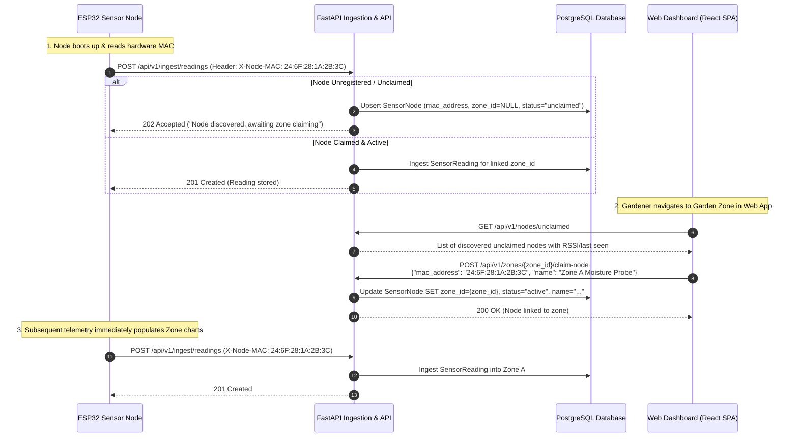

# Architectural Plan: Dynamic ESP32 Node Registration via MAC Addresses

**Branch**: `dynamic-node-registration`  
**Status**: Proposal & Implementation Specification  
**Authors**: MENARA Core Engineering Team  

---

## 1. Executive Summary & Problem Statement

### Current State
Presently, ESP32 sensor nodes authenticate with the FastAPI backend using pre-shared static API keys (`X-Node-Key` header) matched against SHA-256 hashes in the `sensor_nodes` database table. Each board requires:
1. A unique `node_id` (e.g., `esp32-node-01`) and `NODE_API_KEY` defined in `secrets.h` or flashed into Flash NVS.
2. A corresponding pre-seeded database record linking `node_id` to a `zone_id` before physical deployment.

### Challenges
- **Manufacturing & Flashing Bottleneck**: Every single microcontroller board must be individually compiled or flashed with a bespoke firmware binary containing its unique key.
- **Inflexible Zone Assignment**: Moving an ESP32 probe from one planter container to another requires manual database manipulation or re-flashing.
- **Gardener Usability**: Novice urban gardeners cannot easily pair an off-the-shelf ESP32 kit with a newly created plant zone through the web dashboard.

### Proposed Solution
Transition to **Zero-Touch Dynamic Node Registration** based on the ESP32's factory-burned, hardware-unique **MAC address** (`WiFi.macAddress()`, e.g., `24:6F:28:1A:2B:3C`):
1. **Generic Firmware**: All ESP32 nodes run identical firmware without pre-shared API keys.
2. **Auto-Discovery**: Powering on a new node immediately introduces it to the backend discovery queue.
3. **Web UI Pairing**: The gardener claims and links the physical node to any plant zone directly in the web dashboard by selecting from discovered nodes or typing the hardware MAC address.

---

## 2. High-Level System Architecture & Flow



---

## 3. Database Schema Changes

### 3.1 `sensor_nodes` Table Migration
Update the `SensorNode` SQLAlchemy model in [`backend/app/models/sensor_node.py`](file:///C:/Projects/G7_RPLProject_Menara/backend/app/models/sensor_node.py):

```python
class SensorNode(Base, TimestampMixin):
    __tablename__ = "sensor_nodes"

    # Primary key remains string ID or UUID; mac_address is unique hardware identifier
    id = Column(String(50), primary_key=True)  # Can be slugified MAC: "esp32-246f281a2b3c" or custom ID
    mac_address = Column(String(17), unique=True, index=True, nullable=False) # e.g. "24:6F:28:1A:2B:3C"
    name = Column(String(100), nullable=True)  # Friendly label: "Zone A Moisture Probe"
    
    # zone_id is now nullable to permit unclaimed/floating nodes in discovery pool
    zone_id = Column(String(36), ForeignKey("plant_zones.id", ondelete="SET NULL"), nullable=True)
    
    # api_key_hash is made nullable to support MAC-only nodes (backward compatible with legacy keys)
    api_key_hash = Column(String(64), nullable=True)
    
    # Node lifecycle: "unclaimed", "active", "offline", "maintenance"
    status = Column(String(20), default="unclaimed", nullable=False)
    
    # Diagnostics
    last_seen_at = Column(DateTime(timezone=True), nullable=True)
    ip_address = Column(String(45), nullable=True)
    firmware_version = Column(String(20), nullable=True)
    battery_v = Column(Float, nullable=True)
    claimed_at = Column(DateTime(timezone=True), nullable=True)

    # Relationships
    zone = relationship("PlantZone", back_populates="sensor_nodes")
    readings = relationship("SensorReading", back_populates="node", cascade="all, delete-orphan")
```

### 3.2 Alembic Migration Plan
- Create migration script: `alembic revision --autogenerate -m "add_mac_address_and_nullable_zone_to_sensor_nodes"`
- Populate existing seeded nodes with deterministic mock MAC addresses:
  - `esp32-node-01` &rarr; `24:6F:28:01:00:01`
  - `esp32-node-02` &rarr; `24:6F:28:01:00:02`
  - `esp32-node-03` &rarr; `24:6F:28:01:00:03`
  - `esp32-node-04` &rarr; `24:6F:28:01:00:04`

---

## 4. API Endpoints Specification

### 4.1 Ingestion Handshake (`POST /api/v1/ingest/readings`)
- **Headers**:
  - `X-Node-MAC: <mac_address>` (Required if `X-Node-Key` is not present)
  - `X-Node-Key: <api_key>` (Optional, supported for legacy nodes)
- **Payload**: Can also specify `"mac_address": "24:6F:28:1A:2B:3C"` directly in JSON body.
- **Behavior**:
  1. Standardize MAC address to normalized uppercase: `mac.strip().upper()`.
  2. Query `SensorNode` by `mac_address`.
  3. **Case 1: Node Unknown**:
     - Automatically create new `SensorNode(id=f"esp32-{mac_clean.replace(':', '').lower()}", mac_address=mac_clean, status="unclaimed", zone_id=None, last_seen_at=now)`.
     - Respond `202 Accepted` (`{"status": "discovered", "message": "Node discovered, awaiting zone claiming in web app"}`).
  4. **Case 2: Node Known but Unclaimed (`zone_id=None`)**:
     - Update `last_seen_at`, `battery_v`.
     - Respond `202 Accepted` (`{"status": "unclaimed", "message": "Node unclaimed"}`).
  5. **Case 3: Node Claimed & Active (`zone_id` is set)**:
     - Persist `SensorReading` linked to `node.id`.
     - Respond `201 Created` (`{"status": "success", "reading_id": "...", "node_id": node.id}`).

---

### 4.2 Discovery & Claiming Endpoints

#### `GET /api/v1/nodes/unclaimed`
- **Auth**: Bearer JWT (Gardener / Member)
- **Summary**: List unassigned nodes discovered within the last 24 hours.
- **Response `200 OK`**:
```json
[
  {
    "id": "esp32-246f281a2b3c",
    "mac_address": "24:6F:28:1A:2B:3C",
    "status": "unclaimed",
    "first_seen_at": "2026-11-06T19:00:00Z",
    "last_seen_at": "2026-11-06T19:55:12Z",
    "battery_v": 4.12
  }
]
```

#### `POST /api/v1/zones/{zone_id}/claim-node`
- **Auth**: Bearer JWT (Garden Owner / Member)
- **Summary**: Claim an unclaimed node and bind it to a plant zone.
- **Request Body**:
```json
{
  "mac_address": "24:6F:28:1A:2B:3C",
  "name": "Zone B Capsicum Probe"
}
```
- **Validation Rules**:
  - `mac_address` must match format `^([0-9A-Fa-f]{2}[:-]){5}([0-9A-Fa-f]{2})$`.
  - Node must either exist as `unclaimed` or be pre-registered by MAC.
  - If node is already claimed in another garden, returns `409 Conflict` ("Node is already claimed by another zone").
  - Target `zone_id` must belong to a garden the user has access to.
- **Response `200 OK`**:
```json
{
  "status": "claimed",
  "node_id": "esp32-246f281a2b3c",
  "mac_address": "24:6F:28:1A:2B:3C",
  "zone_id": "e2f89c4d-6b5e-4c7b-9f21-728b9c1d3e4f",
  "name": "Zone B Capsicum Probe"
}
```

#### `POST /api/v1/nodes/{id}/unclaim`
- **Auth**: Bearer JWT (Garden Owner only)
- **Summary**: Unbind node from zone, returning it to the unclaimed pool.
- **Response `200 OK`**:
```json
{
  "status": "unclaimed",
  "node_id": "esp32-246f281a2b3c",
  "mac_address": "24:6F:28:1A:2B:3C"
}
```

---

## 5. Firmware Implementation (`hardware/firmware`)

### 5.1 Dynamic MAC Discovery in Firmware
In `hardware/firmware/src/main.cpp`:
```cpp
void setup() {
    Serial.begin(115200);
    // Initialize WiFi
    WiFi.mode(WIFI_STA);
    String macAddress = WiFi.macAddress();
    Serial.printf("[Boot] Hardware MAC Address: %s\n", macAddress.c_str());

    // Configure API client with MAC address instead of static API key
    apiClient.setMacAddress(macAddress.c_str());
    apiClient.setTargetUrl(currentConfig.api_base_url);
}
```

### 5.2 Header Dispatch in `ApiClient`
In `hardware/firmware/src/net/api_client.cpp`:
```cpp
http.begin(client, endpoint);
http.addHeader("Content-Type", "application/json");
http.addHeader("X-Node-MAC", _macAddress); // Send hardware MAC
```

### 5.3 Simplified `secrets.h`
`NODE_ID` and `NODE_API_KEY` are eliminated entirely from the required configuration:
```c
#define WIFI_SSID       "Rooftop_Garden_WiFi"
#define WIFI_PASS       "GardenSecurePass"
#define API_BASE_URL    "https://roofgarden.example.com/api/v1"
```

---

## 6. Frontend Web App Implementation

### 6.1 UI Placement in `GardenProfile.tsx` / Zone Details
Within each zone card:
- **Status Badge**:
  - If a node is bound: Shows `Node: [Node Name] ([MAC]) • Active` with a subtle `Unlink` button.
  - If no node is bound: Shows `No Sensor Node connected` with a prominent `+ Link Sensor Node` button (`.app-btn-secondary`).

### 6.2 `NodeRegistrationModal` Component
A unified dialog following the `app-shell.css` styling standards:
- **Tab 1: Discovered Nodes (Recommended)**:
  - Fetches `/api/v1/nodes/unclaimed`.
  - Shows cards for each discovered node with a radio button:
    - MAC Address: `24:6F:28:1A:2B:3C`
    - Signal: `Last active 2 minutes ago`
    - Battery: `4.15 V (Healthy)`
- **Tab 2: Manual MAC Entry**:
  - Input field formatted for MAC address with automatic uppercase formatting and colon delimiters (`XX:XX:XX:XX:XX:XX`).
  - Helpful hint: *"Find the 12-character MAC address printed on your ESP32 board or package label."*
- **Friendly Name Input**:
  - Text input for naming the device (e.g., *"Hydroponics Bed Probe"*).
- **Actions**:
  - Cancel button (`.app-btn-secondary`).
  - Submit button: `Claim & Link Node` (`.app-btn-primary`).

---

## 7. Security & Risk Analysis

| Risk | Threat Vector | Mitigation Strategy |
|---|---|---|
| **MAC Address Spoofing** | Attacker spoofs an ESP32's MAC to inject false soil moisture or temperature data. | 1. **Tenant Isolation**: Once claimed by Garden A, no other user or garden can hijack or claim the MAC address.<br/>2. **Physical Boundary Validation**: The backend's ingestion service strictly flags out-of-range sensor readings (`is_valid = false`).<br/>3. **Optional Secret Token Handshake**: On first claim, the backend can issue an ephemeral token saved to the node's Flash NVS. |
| **MAC Discovery Flood** | Malicious actor spams `POST /ingest/readings` with random MACs to fill the discovery pool. | 1. Rate limiting on unauthenticated ingest endpoints (e.g., max 10 new discoveries per minute per IP).<br/>2. Scheduled cleanup job: automatically purge unclaimed nodes that have had no telemetry for >48 hours. |
| **Accidental Overwrite** | User tries to claim an already assigned node. | Backend enforces `409 Conflict` unless the node is in `unclaimed` state or belongs to the current user's garden. |

---

## 8. Implementation Phases & Milestones

```
+---------------------------------------------------------------------------------+
|                               ROADMAP & PHASES                                  |
+---------------------------------------------------------------------------------+
| Phase 1: Database & Backend Core Ingestion                                      |
| - Add `mac_address`, make `zone_id` and `api_key_hash` nullable in SensorNode   |
| - Implement MAC extraction & auto-discovery in `ingestion_service.py`           |
| - Add `/nodes/unclaimed`, `/zones/{id}/claim-node`, `/nodes/{id}/unclaim`       |
|                                                                                 |
| Phase 2: Firmware & Hardware Simulator                                          |
| - Update ESP32 firmware to send `X-Node-MAC` using `WiFi.macAddress()`          |
| - Update `scripts/simulate_node.py` with `--mac` parameter                     |
|                                                                                 |
| Phase 3: Frontend Web Dashboard UI                                              |
| - Create `NodeRegistrationModal.tsx` in `frontend/src/components/`              |
| - Add Link/Unlink node controls to `GardenProfile.tsx`                          |
| - Wire up TanStack Query / API client methods                                   |
|                                                                                 |
| Phase 4: Testing & Verification                                                 |
| - Unit tests for MAC normalization, validation, and claim/unclaim logic         |
| - E2E tests in `scripts/test_endpoints.py` for discovery and claiming           |
| - Update `api_docs.md` and `docs/api-contract.md`                              |
+---------------------------------------------------------------------------------+
```

---

## 9. Conclusion

Dynamic MAC-based node registration removes the single biggest operational barrier for deploying physical hardware in urban rooftop gardens. Gardeners will be able to flash a single generic firmware image, plug in their ESP32, and link it immediately to any garden zone from their mobile or desktop browser.
