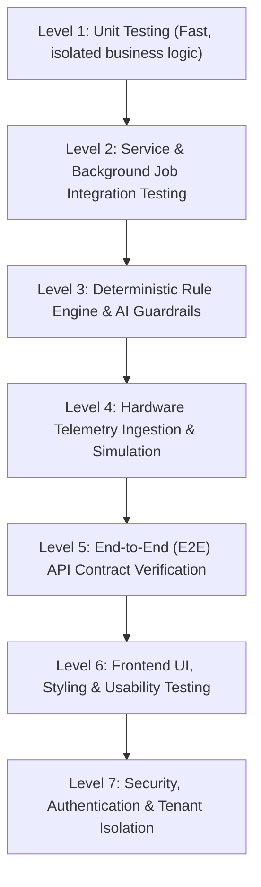
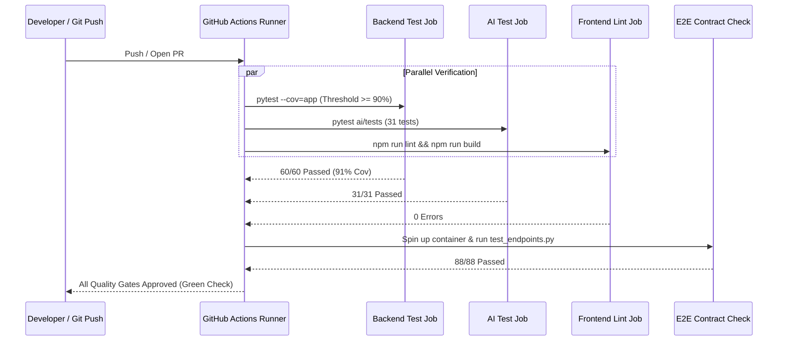

# Software Test Plan (STP)
## MENARA: AI-Powered Roof Garden Monitoring System

---

## Document Control & Metadata

| Field | Detail |
|---|---|
| **Project Name** | MENARA: AI-Powered Roof Garden Monitoring & Automation System |
| **Document Version** | 1.0.0 |
| **Target Release** | Version 1.0 (Production Candidate) |
| **Document Status** | Approved Baseline |
| **Standard Compliance** | Aligned with ISO/IEC/IEEE 29119 & IEEE 829 Software Test Documentation Standards |
| **Primary Scope** | Monorepo (`backend`, `ai`, `frontend`, `hardware`, `scripts`) |

---

## 1. Executive Summary & Purpose

The **AI-Powered Roof Garden Monitoring System (MENARA)** combines IoT hardware telemetry, automated physical actuation, external meteorological forecasting, and probabilistic Large Language Model (LLM) advisory within a single integrated platform. 

Because physical actuators (e.g., solenoid irrigation valves, misters, pumps) operate in real-world rooftop container gardens, software defects carry tangible physical risks: overwatering, root asphyxiation, nutrient leaching, pump motor burnout, and crop loss. Conversely, under-watering in tropical microclimates (>32°C rooftop ambient conditions) can cause irreversible plant wilting within hours.

This **Software Test Plan (STP)** establishes the formal quality engineering strategy, verification levels, automated test suites, acceptance criteria, and governance procedures required to ensure:
1. **Physical Actuator Safety**: Strict deterministic caps (60s maximum duration, 5-minute cooldown) and fail-safe defaults.
2. **AI Guardrail Integrity**: Deterministic botanical rules gate all automated decisions; LLMs cannot invent thresholds or trigger unauthorized hardware actions.
3. **Multi-Tenant Security**: Garden owners and members maintain strict horizontal isolation; unauthorized users cannot observe or control external gardens.
4. **Meteorological Reliability**: Resilient parsing of official BMKG multi-day forecasts and accurate heuristic derivations.
5. **High Software Reliability**: Sustained &ge;90% backend code coverage and 100% passing E2E API contracts.

---

## 2. Scope of Testing

```
+-----------------------------------------------------------------------------+
|                               TESTING SCOPE                                 |
+-----------------------------------------------------------------------------+
|  [IN SCOPE]                                                                 |
|  - FastAPI Backend Service (REST API, JWT Auth, Ingestion Engine)           |
|  - roofgarden_ai Module (Botanical Rules, Linear Predictor, LLM Guardrails) |
|  - Multi-Tenant RBAC & Garden Lifecycle (CRUD, Member Sharing, Cascades)    |
|  - Actuator Hardware Safety (Watchdog caps, cooldown, command queuing)     |
|  - Scheduled Jobs (APScheduler: evaluate_zones, check_node_health, verify)  |
|  - External Connectors (BMKG Forecast API, Open-Elevation API)              |
|  - React SPA Frontend (AppShell layout, unified button styles, telemetry)   |
|  - Hardware Ingestion Simulator (Normal, dry, heatwave scenarios)           |
|                                                                             |
|  [OUT OF SCOPE]                                                             |
|  - Physical destructive stress testing of ESP32 silicon in extreme heat     |
|  - Upstream BMKG server infrastructure availability SLAs                     |
|  - Third-party hosting provider network routing failure simulations         |
+-----------------------------------------------------------------------------+
```

---

## 3. Quality Objectives & Exit Criteria

The release must satisfy all primary quality gates prior to production deployment:

| Metric / Objective | Target Threshold | Current Measure | Verification Method |
|---|---|---|---|
| **Backend Test Coverage** | &ge; 90.0% overall statement coverage | **91.0%** (1467/1616 statements) | `pytest --cov=app backend/tests` |
| **Backend Test Pass Rate** | 100% (0 failures, 0 errors) | **100%** (60/60 passing) | `pytest backend/tests` |
| **AI Module Test Pass Rate** | 100% (0 failures, 0 errors) | **100%** (31/31 passing) | `pytest ai/tests` |
| **E2E REST Contract Conformance** | 100% across all API routes | **100%** (88/88 passing) | `python scripts/test_endpoints.py` |
| **Frontend Static Analysis** | 0 ESLint errors, 0 warnings | **0 errors, 0 warnings** | `npm --prefix frontend run lint` |
| **Frontend TypeScript Build** | Clean build, no compilation errors | **Build passed (6.83s)** | `npm --prefix frontend run build` |
| **Actuator Hardware Safety** | 100% rejection of duration > 60s or rapid trigger | **Verified deterministic** | Unit + E2E automated assertions |
| **LLM Guardrail Fallback** | 100% fallback on schema/metric violation | **Verified deterministic** | `ai/tests/test_guardrails.py` |

---

## 4. Test Strategy & Verification Levels

Testing is structured into seven distinct layers to maximize defect detection early in the software lifecycle:



### 4.1 Level 1: Unit Testing
- **Focus**: Pure functions, data models, schema serialization, cryptographic utilities, and validation logic.
- **Framework**: `pytest`, `pydantic`.
- **Target Components**:
  - Ingestion boundary validators (`soil_moisture_pct` [0-100], `temperature_c` [-10 to 70], `lux` [0 to 120,000]).
  - Password hashing and JWT generation/decoding (`backend/app/core/security.py`).
  - Timezone normalization (`ensure_utc` helper).
  - Meteorological heuristics (`rain_chance_from_desc(desc, tp)` in `bmkg_client.py`).

### 4.2 Level 2: Service & Background Job Integration Testing
- **Focus**: Interaction between SQLAlchemy ORM models, database transactions, and scheduled cron jobs.
- **Framework**: `pytest`, SQLAlchemy with in-memory SQLite (or containerized PostgreSQL).
- **Target Components**:
  - `job_check_node_health`: Evaluates `last_seen_at`; marks nodes `offline` and issues `critical` alerts when `now - last_seen > 3 * send_interval`.
  - `job_verify_actuator_responses`: Queries soil moisture 10 minutes post-irrigation; flags mechanical valve blockages if moisture fails to rise.
  - `evaluate_zones`: Batch evaluation of all active plant zones.

### 4.3 Level 3: Deterministic Rule Engine & AI Guardrails
- **Focus**: Verifying that the probabilistic LLM layer cannot violate horticultural constraints or safety invariants.
- **Framework**: `pytest`, `pytest-mock`.
- **Core Invariants Tested**:
  - **Parameter Categorization**: Categorizes reading as `ok`, `near_limit`, or `out_of_range` strictly against literature baseline thresholds.
  - **Linear Moisture Predictor**: Assesses 6-hour rate of change ($\Delta M = \frac{M_t - M_{t-6}}{6}$) and projects hours until threshold depletion.
  - **Autonomy Safety Gate**: Blocks automated watering if crop risk is high, rain forecast is &ge; 50%, cooldown interval is unexpired, or daily volume cap is reached.
  - **Guardrail Layer**: Enforces exact numerical correspondence ($\pm 1$) between LLM text and actual sensor readings. Falls back to deterministic templates if schema or tone checks fail.

### 4.4 Level 4: Hardware Ingestion & Simulation Testing
- **Focus**: Telemetry stream ingest under simulated physical conditions and edge-case handling.
- **Framework**: `scripts/simulate_node.py`, PlatformIO native tests.
- **Scenarios**:
  - `normal`: Optimal diurnal fluctuations in temperature, humidity, and lux.
  - `dry`: Rapid soil moisture depletion simulating tropical midday drought.
  - `heatwave`: Extreme ambient temperature (>35°C) and low humidity triggering advisory warnings.
  - **Offline Buffering**: Simulates network drops where sensor readings are stored in the ESP32 in-memory ring-buffer and backfilled in bulk with original timestamps once WiFi is restored.

### 4.5 Level 5: End-to-End (E2E) API Contract Verification
- **Focus**: Black-box verification of all published HTTP endpoints against running application containers.
- **Tool**: `scripts/test_endpoints.py` (88 comprehensive test cases).
- **Verification Details**:
  - Validates correct HTTP status codes (200, 201, 204, 400, 401, 403, 404, 409, 422, 429).
  - Validates response schemas against `api_docs.md`.
  - Tests authentication boundaries with valid, expired, malformed, and missing bearer tokens.

### 4.6 Level 6: Frontend UI, Design System & Accessibility Testing
- **Focus**: Visual consistency, button styling enforcement, component state handling, and layout rendering.
- **Tools**: ESLint, Vite TypeScript Compiler (`tsc`), Browser DevTools inspection.
- **Design Invariants Tested**:
  - All interactive buttons must utilize the unified background color classes from `app-shell.css` (`.app-btn-primary`, `.app-btn-secondary`, `.app-btn-danger`, `.app-btn-danger-solid`, `.zone-chip`).
  - All views render inside `Layout.tsx` (`AppShell`) to avoid navigation flicker and inconsistent themes.
  - Color + text accessibility indicators for zone health (never rely on color alone).

### 4.7 Level 7: Security, Authentication & Tenant Isolation Testing
- **Focus**: Prevention of unauthorized access, horizontal privilege escalation, and credential leaks.
- **Key Scenarios Tested**:
  - **Horizontal Tenant Isolation**: Garden B owner cannot view, edit, or delete Garden A, its zones, alerts, recommendations, or actuators.
  - **Role-Based Permissions**: Garden members can view zones and telemetry, but cannot delete the garden, modify garden metadata, or remove other members.
  - **Owner Protection**: Garden owners cannot be removed from their own garden membership list.
  - **Credential Safety**: User passwords hashed with bcrypt; user admin endpoints never expose password hashes.

---

## 5. Traceability Matrix: Requirements to Test Suites

| Requirement ID | Domain Area | Target Requirement | Dedicated Test Suite(s) | Status |
|---|---|---|---|---|
| **REQ-AUTH-01** | Security / Auth | User registration with email uniqueness and password complexity | `test_auth_and_users.py`, `scripts/test_endpoints.py` | PASS |
| **REQ-AUTH-02** | Security / Auth | Case-insensitive email authentication and JWT generation | `test_auth_and_users.py`, `scripts/test_endpoints.py` | PASS |
| **REQ-AUTH-03** | Security / Auth | Profile retrieval (`GET /auth/me`) and modification (`PATCH /auth/me`) | `test_auth_and_users.py`, `scripts/test_endpoints.py` | PASS |
| **REQ-AUTH-04** | Security / Auth | Password reset workflow with token invalidation | `test_auth_and_users.py`, `scripts/test_endpoints.py` | PASS |
| **REQ-GARD-01** | Garden Lifecycle | Multi-tenant garden creation and listing | `test_gardens_and_profile.py`, `test_gardens_members_lifecycle.py` | PASS |
| **REQ-GARD-02** | Garden Lifecycle | Garden metadata update (`PATCH /gardens/{id}`) restricted to owner | `test_gardens_members_lifecycle.py`, `scripts/test_endpoints.py` | PASS |
| **REQ-GARD-03** | Garden Lifecycle | Garden deletion with cascading cleanup of zones, alerts, profiles | `test_gardens_members_lifecycle.py`, `scripts/test_endpoints.py` | PASS |
| **REQ-GARD-04** | Collaboration | Member invitation, duplicate detection, and member removal | `test_gardens_members_lifecycle.py`, `scripts/test_endpoints.py` | PASS |
| **REQ-ZONE-01** | Agronomy / Zones | Baseline botanical category listing with ideal microclimate ranges | `test_gardens_and_profile.py`, `scripts/test_endpoints.py` | PASS |
| **REQ-ZONE-02** | Agronomy / Zones | Zone telemetry status evaluation and out-of-range parameter flagging | `test_zone_status.py`, `test_readings.py` | PASS |
| **REQ-ZONE-03** | Agronomy / Zones | Historical telemetry aggregation (24h raw, 7d hourly, 30d views) | `test_readings.py`, `scripts/test_endpoints.py` | PASS |
| **REQ-ACTU-01** | Hardware / Safety | Manual actuator command queuing (`turn_on`, `turn_off`) | `test_commands.py`, `test_actuators_and_commands.py` | PASS |
| **REQ-ACTU-02** | Hardware / Safety | Hard cap duration to maximum 60 seconds | `test_actuators_and_commands.py`, `test_commands.py` | PASS |
| **REQ-ACTU-03** | Hardware / Safety | Enforce 5-minute cooldown between manual actuator activations | `test_actuators_and_commands.py`, `scripts/test_endpoints.py` | PASS |
| **REQ-INGE-01** | Hardware / Ingest | Sensor reading ingestion authenticated via `X-Node-Key` | `test_ingestion.py`, `scripts/simulate_node.py` | PASS |
| **REQ-INGE-02** | Hardware / Ingest | Boundary validation and `is_valid=false` anomaly flagging | `test_ingestion.py` | PASS |
| **REQ-METE-01** | External API | BMKG multi-day forecast time-series slot alignment to UTC now | `test_bmkg_client.py`, `ai/tests/test_bmkg_client.py` | PASS |
| **REQ-METE-02** | External API | Derivation of rain chance percentage via precipitation heuristics | `test_bmkg_client.py`, `ai/tests/test_bmkg_client.py` | PASS |
| **REQ-JOBS-01** | Automation | Stale sensor node offline detection and alert emission | `test_jobs_and_internal.py` | PASS |
| **REQ-JOBS-02** | Automation | Post-irrigation soil moisture verification and blockage alert | `test_jobs_and_internal.py` | PASS |
| **REQ-AI-01** | Agentic AI | Autonomy gating: block watering if rain forecast &ge; 50% | `ai/tests/test_autonomy.py` | PASS |
| **REQ-AI-02** | Agentic AI | 6-hour linear moisture depletion slope forecasting | `ai/tests/test_predictor.py` | PASS |
| **REQ-AI-03** | Agentic AI | Strict LLM guardrail validation and deterministic fallback template | `ai/tests/test_guardrails.py` | PASS |
| **REQ-UI-01** | Frontend UI | Unified button styling hierarchy across all dashboard views | `frontend/src/styles/app-shell.css`, ESLint | PASS |

---

## 6. Test Environments & Test Data Strategy

### 6.1 Test Environments

```
+----------------------------------------------------------------------------------+
|                            TEST ENVIRONMENT TOPOLOGY                             |
+----------------------------------------------------------------------------------+
| 1. Unit & Local Test Environment                                                 |
|    - Engine: Python 3.11 (.venv) + Node.js 20                                    |
|    - Database: SQLite (in-memory with foreign key pragmas)                       |
|    - Network: Mocked HTTP transport (httpx mock / pytest-mock)                   |
|    - Speed: ~10 seconds for full 91-test pytest suite                            |
|                                                                                  |
| 2. Containerized Integration Environment (Docker Compose)                        |
|    - Database: PostgreSQL 16 + TimescaleDB + pgvector extension                  |
|    - Backend: FastAPI (uvicorn inside roofgarden_backend container)              |
|    - Frontend: Vite SPA served via Nginx reverse proxy                           |
|    - External APIs: BMKG live sandbox / Open-Elevation sandbox                   |
|                                                                                  |
| 3. Hardware Simulation Environment                                               |
|    - Simulator: Python script (scripts/simulate_node.py)                         |
|    - Telemetry payloads with simulated battery discharge & soil drying curves   |
+----------------------------------------------------------------------------------+
```

### 6.2 Test Data Management & Fixtures

1. **Pre-Seeded Botanical Baselines**:
   - [`scripts/seed_demo_data.py`](file:///C:/Projects/G7_RPLProject_Menara/scripts/seed_demo_data.py) seeds standard Jakarta baseline data:
     - 4 Plant Categories (`leafy`, `fruiting_veg`, `herbs`, `fruit_potted`).
     - 4 Literature Threshold Profiles.
     - 1 Demo Rooftop Garden (Menteng, Jakarta Pusat; `adm4` code `31.71.06.1001`).
     - 4 Active Zones with attached Sensor Nodes and Actuators.
     - 24 hours of synthetic sensor readings.
2. **Pytest Fixtures (`backend/tests/conftest.py`)**:
   - `db_session`: In-memory isolated database session per test with automatic teardown.
   - `client`: `fastapi.testclient.TestClient` configured with database dependency overrides.
   - `auth_headers`: Valid JWT bearer token for the default mock gardener.
   - `outsider_auth_headers`: Valid JWT bearer token for a secondary isolated user.

---

## 7. Defect Management & Severity Classification

Defects identified during testing are prioritized and tracked according to risk to physical hardware and horticultural health:

```
+------------------------------------------------------------------------------+
|                     DEFECT SEVERITY & SLA CLASSIFICATION                     |
+------------------------------------------------------------------------------+
| [SEV-1] CRITICAL / BLOCKER                                                   |
| Description: Actuator hardware timeout failure, unauthorized watering,       |
|              cross-tenant data leakage, auth bypass, unhandled crash in job. |
| SLA: Immediate fix; blocks release deployment.                               |
|                                                                              |
| [SEV-2] MAJOR                                                                |
| Description: Botanical rule engine calculation error, BMKG payload mismatch, |
|              guardrail fallback failure, inaccurate depletion forecasting.   |
| SLA: Fix required within 24 hours.                                           |
|                                                                              |
| [SEV-3] MINOR                                                                |
| Description: Frontend CSS styling non-compliance, telemetry chart axis typo, |
|              non-blocking logging warning, minor documentation omission.     |
| SLA: Scheduled within current release sprint.                                |
|                                                                              |
| [SEV-4] TRIVIAL                                                              |
| Description: Cosmetic alignment quirks, minor color contrast variations.    |
| SLA: Backlog improvement.                                                    |
+------------------------------------------------------------------------------+
```

---

## 8. Test Execution Procedures & Automated Commands

### 8.1 Backend Unit & Integration Tests (with Coverage)
```bash
# From repository root
cd backend
pytest -v --cov=app --cov-report=term-missing tests/
```
*Expected Result: 60 passed, &ge; 90% coverage.*

### 8.2 AI Module Tests
```bash
cd ai
pytest -v
```
*Expected Result: 31 passed.*

### 8.3 End-to-End REST API Contract Suite
Ensure the backend service is running (`http://localhost:8000`):
```bash
# From repository root
python scripts/test_endpoints.py
```
*Expected Result: 88/88 passed (100%), updates api_docs.md.*

### 8.4 Frontend Static Analysis & Production Build
```bash
cd frontend
npm run lint
npm run build
```
*Expected Result: 0 errors, 0 warnings; successful production bundle generation.*

### 8.5 Sensor Ingestion Hardware Simulator
```bash
# In an active terminal:
python scripts/simulate_node.py --scenario normal --interval 10
# Simulate dry drought stress:
python scripts/simulate_node.py --scenario dry --interval 5
```

---

## 9. Continuous Integration (CI) Workflow Integration

Every pull request to `main` must execute the following automated verification matrix:



---
